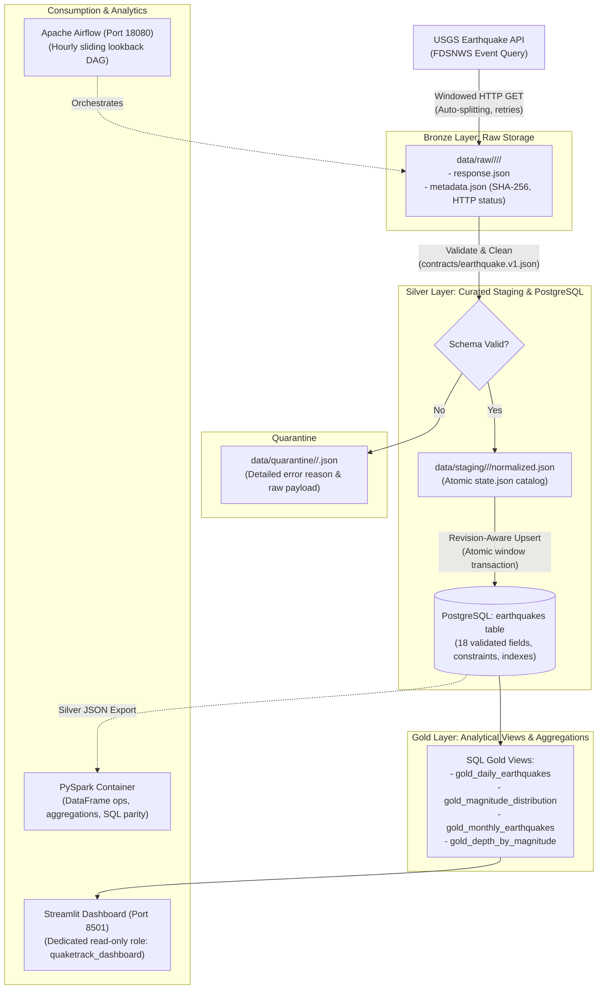

# QuakeTrack 🌍⚡

**QuakeTrack** is an end-to-end, production-grade Data Engineering and Analytics Pipeline for global seismic activity. It extracts real-time and historical earthquake event records from the **United States Geological Survey (USGS) Earthquake API**, validates and normalizes them through a strict data contract, persists them idempotently into a relational PostgreSQL data warehouse, automates incremental ingestion with Apache Airflow, and serves an interactive multi-page analytics dashboard built with Streamlit and Plotly.

The project demonstrates core data engineering disciplines: resilient REST API extraction, raw payload preservation (Bronze), schema validation and quarantine (Silver), analytical data modeling (Gold), idempotency and revision-aware upserts, pipeline observability, role-based least privilege, and containerized big data processing (PySpark).

---

## Table of Contents

- [1. Project Overview & Objectives](#1-project-overview--objectives)
- [2. System Architecture & Medallion Design](#2-system-architecture--medallion-design)
- [3. Technology Stack](#3-technology-stack)
- [4. Features Implemented & How They Work](#4-features-implemented--how-they-work)
  - [A. Resilient Extraction & Raw Archival (Bronze)](#a-resilient-extraction--raw-archival-bronze)
  - [B. Validation, Normalization & Quarantine (Silver)](#b-validation-normalization--quarantine-silver)
  - [C. PostgreSQL Persistence & Analytical Views (Gold)](#c-postgresql-persistence--analytical-views-gold)
  - [D. Airflow Orchestration & Incremental Ingestion](#d-airflow-orchestration--incremental-ingestion)
  - [E. Interactive Analytics Dashboard](#e-interactive-analytics-dashboard)
  - [F. Data Contracts & Governance](#f-data-contracts--governance)
  - [G. Containerized PySpark Demonstration](#g-containerized-pyspark-demonstration)
- [5. Project Directory Structure](#5-project-directory-structure)
- [6. Getting Started & How to Run](#6-getting-started--how-to-run)
  - [Prerequisites](#prerequisites)
  - [1. Environment Setup & Installation](#1-environment-setup--installation)
  - [2. Start PostgreSQL & Run Migrations](#2-start-postgresql--run-migrations)
  - [3. Ingest Historical Data (Backfill)](#3-ingest-historical-data-backfill)
  - [4. Launch the Streamlit Dashboard](#4-launch-the-streamlit-dashboard)
  - [5. Run Airflow Orchestration (Optional Profile)](#5-run-airflow-orchestration-optional-profile)
  - [6. Run PySpark Syllabus Demo (Optional Profile)](#6-run-pyspark-syllabus-demo-optional-profile)
- [7. CLI Reference & Operations Cheatsheet](#7-cli-reference--operations-cheatsheet)
- [8. Testing & Quality Verification](#8-testing--quality-verification)
- [9. Safe Shutdown & Maintenance](#9-safe-shutdown--maintenance)

---

## 1. Project Overview & Objectives

### The Problem
Public earthquake feeds provided by the USGS are dynamic: events are added continuously, locations and depths are refined as additional seismograph data arrives, and magnitudes are updated hours or days after an event. Naive ingestion strategies suffer from:
1. **Silent record loss** due to API pagination and query caps (USGS limits queries to 20,000 records, but practical HTTP stability caps requests at 1,000 records).
2. **Duplicate or regressed records** when re-fetching recent time windows without revision awareness.
3. **Boundary duplication** when querying discrete time windows without millisecond precision.
4. **Data corruption** when unexpected schemas, null coordinates, or invalid measurements enter production tables.

### What QuakeTrack Does
- **Ingests Real-World Data**: Fetches seismic events across user-defined date ranges and magnitude thresholds.
- **Ensures Zero Data Loss**: Recursively auto-splits time windows if the USGS 1,000-record query cap is reached, preventing silent truncation.
- **Maintains Audit Provenance**: Stores raw immutable HTTP responses with SHA-256 cryptographic checksums before any transformation.
- **Enforces Data Contracts**: Validates records against a strict 18-field schema specification, quarantining corrupted records with detailed diagnostic failure reasons.
- **Provides Idempotency**: Implements revision-aware PostgreSQL upserts using the USGS `updated` timestamp. Newer revisions update existing rows; identical or older revisions are safely flagged `unchanged`.
- **Automates Incremental Updates**: Uses Apache Airflow with a sliding 72-hour lookback window to catch recalculated parameters. Advances checkpoints only when both DB persistence and post-load data quality checks pass.
- **Delivers Interactive Insights**: Serves an analytics interface with global maps, offline coordinate fallback mode, frequency histograms, depth/magnitude scatters, paginated data grids, and lossless CSV export.

---

## 2. System Architecture & Medallion Design

QuakeTrack follows a structured **Medallion Architecture** (Bronze ➔ Silver ➔ Gold):



| Layer | Implementation | Description |
|---|---|---|
| **Bronze** | `data/raw/` | Exact original API response payloads, HTTP metadata, retry counters, and SHA-256 hashes. Read-only and immutable. |
| **Silver** | `data/staging/` & `earthquakes` table | Normalized, typed event records (18 fields). Cleaned coordinates, preserved negative depths/magnitudes, and quarantined outliers. |
| **Gold** | SQL Views (`gold_*`) | Pre-aggregated analytical views in PostgreSQL for daily activity, magnitude distributions, monthly counts, and depth correlations. |

---

## 3. Technology Stack

| Domain | Technology | Version | Purpose |
|---|---|---|---|
| **Core Language** | Python | 3.11 – 3.14 (3.14 tested on host, 3.12 in Docker) | ETL logic, validation, CLI tools, database loaders |
| **Relational Database** | PostgreSQL | 17 (App DB) / 16 (Airflow DB) | Persistent warehouse, ACID transactions, Gold views |
| **Database Tooling** | SQLAlchemy & psycopg3 | 2.1.6 / 3.3.6 (binary) | Connection pooling, typed queries, migration execution |
| **Workflow Orchestration** | Apache Airflow | 3.3.2 (LocalExecutor) | Hourly incremental scheduling, quality-gated checkpoints |
| **Web Dashboard** | Streamlit & Plotly | 1.66.1 / 7.1.0 | Interactive UI, charts, map visualizer, CSV export |
| **Big Data / Distributed** | Apache Spark (PySpark) | 4.1.3 (OpenJDK 17) | Dockerized DataFrame transformations & Gold parity verification |
| **Testing & Quality** | pytest & AppTest | 9.1.1 | Unit testing, isolated database integration tests, UI testing |
| **Containerization** | Docker & Docker Compose | v2+ | Multi-container profiles (`postgres`, `airflow`, `dashboard`, `spark`) |

---

## 4. Features Implemented & How They Work

### A. Resilient Extraction & Raw Archival (Bronze)
- **Windowed Temporal Chunking**: Splits large date ranges into discrete windows (default 1 day or 0.5 day).
- **Millisecond Precision Boundary Handling**: USGS queries use inclusive bounds. QuakeTrack offsets window end-times by 1 millisecond (`endtime = next_window_start - 1ms`), completely preventing boundary duplicate events.
- **Dynamic Auto-Splitting**: If an API response returns 1,000 records (the USGS cap), the window is recursively halved until all records are guaranteed complete. Capped responses are archived as audit trails, but only complete leaf windows are committed.
- **Exponential Backoff**: Automatic retries for HTTP 429 (rate limits) and 5xx (server errors) with configurable backoff.
- **Immutable Archival**: Every raw payload is saved to `data/raw/<run_id>/<request_hash>/<response_id>/` with an accompanying `metadata.json` containing the request URL, parameters, fetch timestamp, HTTP status, attempt count, and SHA-256 checksum.

### B. Validation, Normalization & Quarantine (Silver)
- **Strict Data Contract**: Validates all records against [contracts/earthquake.v1.json](file:///d:/Global-Earthquake-Data-Engineering-Analytics-Pipeline/contracts/earthquake.v1.json).
- **Measurement Policy**: Unknown/null measurements remain `null`; they are **never** coerced to zero (which would falsely imply a 0.0 magnitude or sea-level depth). Valid negative depths and magnitudes are preserved.
- **Automated Quarantine**: Malformed features (e.g. missing IDs, coordinates out of [-90, 90] / [-180, 180] bounds, non-numeric timestamps) are rejected and written to `data/quarantine/<run_id>/<window_key>.json` with full diagnostic failure reasons.
- **Atomic Staging State**: Generates `normalized.json` batches and an atomically written `state.json` catalog containing unique local IDs and checkpoint manifests.

### C. PostgreSQL Persistence & Analytical Views (Gold)
- **Schema Migrations**: Explicit, numbered SQL migrations (`001` through `005` in `sql/migrations/`) executed through `quaketrack.cli migrate`. No schema changes occur silently at application startup.
- **Revision-Aware Upserts**: When inserting records, QuakeTrack checks the incoming `source_updated_at` against the stored `source_updated_at`:
  - **Newer revision**: The record is updated with new coordinates, magnitude, or depth.
  - **Equal or older revision**: The record is flagged `unchanged`, preventing stale overwrite.
  - **Re-runs**: Completely idempotent; running the pipeline twice produces 0 new records.
- **Operational Auditing**: Every loading operation records run metadata in `ingestion_runs`, chunk execution in `ingestion_chunks`, pipeline state in `pipeline_state`, and health indicators in `pipeline_health`.
- **Analytical Gold Views**:
  - `gold_daily_earthquakes`: Daily event counts, minimum, average, and maximum magnitudes.
  - `gold_magnitude_distribution`: Event counts bucketed into magnitude classes (Minor, Light, Moderate, Strong, Major, Great).
  - `gold_monthly_earthquakes`: Month-by-month historical event counts and average depths.
  - `gold_depth_by_magnitude`: Cross-tabulated depth buckets vs. magnitude brackets.
- **Offline Replay**: Full capability to rebuild the database from scratch (`quaketrack replay`) using only Bronze archives, with zero external network calls.

### D. Airflow Orchestration & Incremental Ingestion
- **Hourly Pipeline DAG**: Containerized Airflow 3.3.2 running under LocalExecutor with its own isolated PostgreSQL metadata DB.
- **Sliding Lookback Window**: Evaluates the past 72 hours on each incremental run (`INCREMENTAL_LOOKBACK_HOURS=72`) to capture retroactive USGS event updates.
- **Quality-Gated Checkpoints**: The pipeline checkpoint in `pipeline_state` advances **only** after two conditions are met:
  1. PostgreSQL transaction commits successfully.
  2. Post-load data quality and contract verification passes.
- **Paused by Default**: Fresh deployments initialize with the DAG in a paused state to prevent uncontrolled background API requests until approved.

### E. Interactive Analytics Dashboard
Built with Streamlit, the application connects to PostgreSQL using a dedicated read-only role (`quaketrack_dashboard`) and features a navy/teal responsive interface across 5 core pages:
1. **Overview**: High-level KPIs (total events, max magnitude, depth metrics), recent activity feed, daily trend charts, and strongest events table.
2. **Earthquake Map**: Global geospatial scatter plot of epicenters color-coded by magnitude and depth. Includes an **Offline Coordinate View** fallback that renders longitude/latitude axes without requiring external map tile servers.
3. **Trends & Distributions**: Magnitude frequency histograms, depth vs. magnitude scatter plots, and temporal density patterns.
4. **Data Explorer**: Deterministic sorting, paginated tabular views (25/50/100 rows per page), column filters, and lossless UTF-8 CSV export (up to 10,000 rows).
5. **Pipeline Operations & Monitoring**: Live view of ingestion runs, chunk audit status, data freshness metrics, checkpoint lag, and data contract compliance summaries.
- **Security & Caching**: Database queries run with strict read-only transactions; credentials are never rendered. Queries are cached for 60 seconds with an immediate "Refresh" invalidation trigger.

### F. Data Contracts & Governance
- Formal JSON Schema definition in [contracts/earthquake.v1.json](file:///d:/Global-Earthquake-Data-Engineering-Analytics-Pipeline/contracts/earthquake.v1.json) covering 18 fields, coordinate bounding boxes, and timestamp precision.
- Built-in validation suite (`python -m quaketrack.phase6 --verify-archives`) verifying that 100% of persisted Silver rows match their Bronze archive checksums and schema requirements.

### G. Containerized PySpark Demonstration
- Standalone Docker container running **PySpark 4.1.3** and **OpenJDK 17**.
- Reads Silver snapshots exported from PostgreSQL and demonstrates distributed computing patterns:
  - Strongly-typed DataFrame schema projection.
  - Transformations: `filter`, `select`, `withColumn`, `groupBy`, and window functions.
  - Spark SQL temporary views and aggregation queries.
  - Automated parity verification comparing Spark outputs against PostgreSQL Gold views.
- Operates independently: PySpark is not required for normal host ETL or dashboard operation.

---

## 5. Project Directory Structure

```text
Global-Earthquake-Data-Engineering-Analytics-Pipeline/
├── .env.example                 # Environment template with connection & pipeline parameters
├── docker-compose.yml           # Multi-service composition (postgres, airflow, dashboard, spark)
├── pyproject.toml               # Python package configuration and dependencies
├── requirements-lock.txt        # Pinned base ETL dependencies
├── requirements-dashboard-lock.txt # Pinned Streamlit dashboard dependencies
├── contracts/
│   └── earthquake.v1.json       # Formal JSON Schema contract for normalized Silver events
├── dags/
│   └── earthquake_ingestion_dag.py # Airflow hourly incremental ingestion DAG
├── dashboard/
│   └── app.py                   # Streamlit application entrypoint
├── data/
│   ├── raw/                     # Bronze: Immutable API response archives with SHA-256 metadata
│   ├── quarantine/              # Quarantined malformed records with failure diagnostic reasons
│   └── staging/                 # Silver: Normalized batches, catalogs, and state checkpoints
├── docker/
│   ├── airflow/Dockerfile       # Custom Airflow 3.3.2 image with quaketrack installed
│   ├── dashboard/Dockerfile     # Lightweight Streamlit container
│   └── spark/Dockerfile         # PySpark 4.1.3 + OpenJDK 17 demonstration container
├── docs/                        # Complete architecture docs, phase reports, and run guides
├── scripts/
│   ├── check_api.py             # USGS API connectivity test
│   ├── setup_airflow.py         # Airflow database and credential initializer
│   ├── setup_dashboard.py       # Dedicated read-only dashboard role creator
│   ├── verify_airflow_dag.py    # DAG syntax and task structure validator
│   ├── verify_dashboard.py      # AppTest automated dashboard test suite
│   ├── verify_database.py       # PostgreSQL connectivity check
│   └── verify_phase*.py         # Phase-specific verification suites
├── sql/
│   ├── migrations/              # Numbered schema migrations (001 to 005)
│   └── analytics/               # Parameterized analytical queries
├── src/quaketrack/
│   ├── cli.py                   # Command-line interface entry point
│   ├── config.py                # Environment configuration loader
│   ├── governance.py            # Data contract validator and quality reporter
│   ├── orchestration.py         # Incremental window logic and checkpoint manager
│   ├── pipeline.py              # Core extraction, window splitting, and staging pipeline
│   ├── spark_demo.py            # PySpark DataFrame transformations and Gold parity checks
│   ├── dashboard/               # Streamlit pages, charts, data access, and security layer
│   ├── ingestion/               # USGS HTTP client, windowing algorithms, raw archiver
│   ├── monitoring/              # Run metrics, counters, and reconciliation
│   ├── storage/                 # Database engine, migrations, loaders, and upsert logic
│   └── transforms/              # Normalizer, schema validator, deduplicator, quarantine
└── tests/                       # Complete pytest suite (offline units + isolated DB integration)
```

---

## 6. Getting Started & How to Run

### Prerequisites
- **Operating System**: Windows, macOS, or Linux (PowerShell commands are shown below for Windows).
- **Docker Desktop**: With Linux containers enabled.
- **Python**: Version 3.11, 3.12, 3.13, or 3.14.
- **Git**: For version control.

---

### 1. Environment Setup & Installation

Clone the repository and initialize the Python virtual environment:

```powershell
# 1. Clone the repository
git clone https://github.com/neilsenvaz10/Global-Earthquake-Data-Engineering-Analytics-Pipeline.git
cd Global-Earthquake-Data-Engineering-Analytics-Pipeline

# 2. Create and activate virtual environment
python -m venv .venv
.\.venv\Scripts\Activate.ps1

# 3. Install dependencies in editable mode
.\.venv\Scripts\python -m pip install -e ".[dev,dashboard]"

# 4. Copy environment configuration
if (-not (Test-Path .env)) { Copy-Item .env.example .env }
```

> [!NOTE]
> The default configuration binds PostgreSQL to port `55432` (`localhost:55432`) to avoid conflicts with existing local PostgreSQL installations on port `5432`. Ensure your `.env` has `POSTGRES_PORT=55432`.

---

### 2. Start PostgreSQL & Run Migrations

Start the PostgreSQL 17 database container and apply the schema migrations:

```powershell
# 1. Start the PostgreSQL container
docker compose up -d --wait postgres

# 2. Verify database connectivity
.\.venv\Scripts\python scripts/verify_database.py

# 3. Apply schema migrations (creates tables, operational logs, and Gold views)
.\.venv\Scripts\python -m quaketrack.cli migrate
```

---

### 3. Ingest Historical Data (Backfill)

Run a bounded historical extraction from the USGS API. You can stage and load into PostgreSQL in a single command:

```powershell
# Ingest 1 day of real earthquakes (magnitude >= 4.0) into staging and load into PostgreSQL:
.\.venv\Scripts\python -m quaketrack.cli backfill --start 2026-10-01 --end 2026-10-02 --min-magnitude 4 --window-days 0.5 --output-dir data/staging/demo --load-database
```

Key options for `backfill`:
- `--start`: Inclusive UTC start date/timestamp (`YYYY-MM-DD` or ISO 8601).
- `--end`: Exclusive UTC end date/timestamp (`YYYY-MM-DD` or ISO 8601).
- `--min-magnitude`: Minimum Richter/moment magnitude filter (e.g. `4.0` or `2.5`).
- `--window-days`: Size of each extraction slice (e.g. `0.5` or `1`).
- `--output-dir`: Destination folder for local staging artifacts.
- `--load-database`: Automatically persists validated records into PostgreSQL.
- `--resume`: Reuses verified existing staging checkpoints, fetching only incomplete windows.

To verify idempotency, run the exact same command with `--resume`:
```powershell
.\.venv\Scripts\python -m quaketrack.cli backfill --start 2026-10-01 --end 2026-10-02 --min-magnitude 4 --window-days 0.5 --output-dir data/staging/demo --load-database --resume
```
*Notice that matching windows are skipped and the database reports 0 new rows inserted.*

---

### 4. Launch the Streamlit Dashboard

You can run the dashboard either **directly on the host** (recommended for interactive development) or **in a Docker container**.

#### Option A: Run Directly on Host (Fastest)
```powershell
# Create the read-only dashboard role
.\.venv\Scripts\python scripts/setup_dashboard.py

# Launch Streamlit
.\.venv\Scripts\python -m streamlit run dashboard/app.py
```
Open your browser at **[http://localhost:8501](http://localhost:8501)**.

#### Option B: Run in Docker
```powershell
# Build and launch the containerized dashboard
.\.venv\Scripts\python scripts/setup_dashboard.py
docker compose --profile dashboard build dashboard
docker compose --profile dashboard up -d --wait dashboard
```
Open your browser at **[http://localhost:8501](http://localhost:8501)**.

---

### 5. Run Airflow Orchestration (Optional Profile)

To inspect or run scheduled incremental ingestion through Apache Airflow:

```powershell
# 1. Initialize Airflow credentials and connection configuration
.\.venv\Scripts\python scripts/setup_airflow.py

# 2. Build and launch Airflow and its metadata database
docker compose --profile airflow build airflow
docker compose --profile airflow up -d --wait airflow
```

- Open the Airflow Web UI at **[http://localhost:18080](http://localhost:18080)**.
- **Username**: `admin`
- **Password**: The `AIRFLOW_ADMIN_PASSWORD` generated in your `.env`.
- The DAG `earthquake_ingestion_dag` is created **paused** by default. Unpause it in the UI or trigger a manual run to test incremental updates.

To stop Airflow without removing database volumes:
```powershell
docker compose --profile airflow stop airflow airflow-db
```

---

### 6. Run PySpark Syllabus Demo (Optional Profile)

To run the PySpark big data transformation and Gold view parity verification in an isolated Docker container:

```powershell
# 1. Generate the Silver JSON snapshot and quality contract report
.\.venv\Scripts\python -m quaketrack.phase6 --verify-archives

# 2. Build and run the PySpark container
docker compose --profile spark build spark
docker compose --profile spark run --rm spark

# 3. Run PySpark unit tests inside the container
docker compose --profile spark run --rm spark python -m pytest tests/spark -q -p no:cacheprovider
```

---

## 7. CLI Reference & Operations Cheatsheet

The `quaketrack` CLI provides full control over migrations, ETL, offline replay, and analytical queries:

```powershell
# Show help and available commands
.\.venv\Scripts\python -m quaketrack.cli --help

# 1. Database Migrations
.\.venv\Scripts\python -m quaketrack.cli migrate

# 2. Historical Backfill
.\.venv\Scripts\python -m quaketrack.cli backfill --start 2026-10-01 --end 2026-10-03 --min-magnitude 4.0 --load-database

# 3. Load Previously Staged Artifacts into PostgreSQL
.\.venv\Scripts\python -m quaketrack.cli load-staging --staging-dir data/staging/demo --resume

# 4. Offline Replay (Rebuild PostgreSQL directly from Bronze archives with NO network calls)
.\.venv\Scripts\python -m quaketrack.cli replay --staging-dir data/staging/demo

# 5. Run Parameterized Analytical Queries via CLI
.\.venv\Scripts\python -m quaketrack.cli analytics overview --start 2026-10-01 --end 2026-10-02
.\.venv\Scripts\python -m quaketrack.cli analytics daily_counts --start 2026-10-01 --end 2026-10-03
.\.venv\Scripts\python -m quaketrack.cli analytics strongest_events --start 2026-10-01 --end 2026-10-03 --limit 5
```

---

## 8. Testing & Quality Verification

QuakeTrack features a multi-tiered test suite covering unit logic, isolated database integration, Airflow DAG integrity, and Streamlit UI flows.

```powershell
# 1. Run offline unit tests (transforms, normalizers, validators, windowing, deduplication)
New-Item -ItemType Directory -Force .pytest_tmp | Out-Null
.\.venv\Scripts\python -m pytest -q --basetemp=.pytest_tmp/local-check

# 2. Run isolated database integration tests
# (Automatically provisions and tears down an isolated temporary database quaketrack_test_<uuid>)
.\.venv\Scripts\python -m pytest --database-tests -q --basetemp=.pytest_tmp/db-check

# 3. Check Python dependency compatibility
.\.venv\Scripts\python -m pip check

# 4. Test Airflow DAG structure and task graph
docker compose exec -T airflow python /workspace/scripts/verify_airflow_dag.py

# 5. Run comprehensive dashboard automated AppTest suite
.\.venv\Scripts\python scripts/verify_dashboard.py
```

---

## 9. Safe Shutdown & Maintenance

To stop all running services without losing database records or pipeline state:

```powershell
# Stop dashboard container
docker compose --profile dashboard stop dashboard

# Stop Airflow containers
docker compose --profile airflow stop airflow airflow-db

# Stop PostgreSQL
docker compose stop postgres
```

> [!CAUTION]
> **Never run `docker compose down -v`** unless you explicitly intend to delete all stored database volumes (`postgres_data`, `airflow_metadata`, `airflow_home`).
