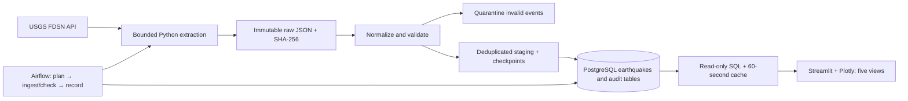

# QuakeTrack: a 4–5 minute demonstration

Before presenting, start the services using README, open the dashboard at
http://localhost:8501 and Airflow at http://localhost:18080, and log into Airflow
using the local admin password without showing it on screen. Keep the DAG paused.
Restore broad dashboard filters, refresh the data, and keep the Phase 5 report open.
The current 40-event dataset is intentionally small and incomplete.

## 0:00–0:35 · Introduction and problem

“QuakeTrack turns USGS earthquake observations into a repeatable, auditable data
pipeline. The problem is not just plotting points: APIs can fail, records can be
revised, and repeated downloads can create duplicates. We preserve the source,
validate events, load PostgreSQL safely, and expose both analytics and operations.”

Explain that this is descriptive data engineering, not earthquake prediction.

## 0:35–1:05 · Architecture



Point out the separate Airflow metadata DB and the original application DB on
55432. Airflow schedules the ETL; Streamlit reads curated data.

## 1:05–1:40 · Ingestion and PostgreSQL

Show one existing raw response and its metadata in `data/raw`, without opening
`.env`. Explain request bounds, retry history and SHA-256. Source bytes are kept
even if an event later fails validation. Show this read-only database result:

```powershell
.\.venv\Scripts\python -m quaketrack.cli analytics overview --start 2026-10-01 --end 2026-10-26
```

Expected verified sample: 40 events, maximum magnitude 5.9, average depth
65.146925 km. Dates are UTC and the CLI end is exclusive. Event IDs are primary
keys; newer source revisions can update a row without creating a second event.

For a live ingestion demonstration, use only the small six-hour verification
below, preferably run before the presentation and show its saved result. It
performs one real request and creates new audit artifacts, while matching events
remain unchanged unless USGS publishes a newer revision:

```powershell
docker compose exec -T airflow python /workspace/scripts/verify_phase5_airflow.py
```

## 1:40–2:20 · Airflow, quality and idempotency

Open `quaketrack_earthquake_ingestion` and show its three tasks. Show the successful
Phase 5 manual test, then its application counters: fetched 12, inserted 0,
updated 0, unchanged 12, quarantined 0. Explain that `dags test --use-executor`
ran real LocalExecutor tasks while the DAG stayed paused. This does not prove
an unattended hourly tick ran during Phase 5. Do not click the unpause toggle.

Show the earlier Phase 4 recovery evidence if asked about retries. Failure
simulation is currently disabled. Quality checks reconcile counts, source
replay, required fields and duplicates before advancing incremental coverage.

## 2:20–4:05 · Dashboard walkthrough

1. **Overview:** show total 40, strongest 5.9, mean magnitude 4.6175, mean depth
   65.146925 km. Read the coverage notice: events on only October 1 and 25,
   with different magnitude thresholds. Explain distinct event/update/ingest ages.
2. **Earthquake Map:** hover a point, zoom and pan. Show time, magnitude,
   depth and source location. Epicenters do not represent damage zones.
3. **Trends:** switch daily → weekly → monthly, inspect depth and magnitude
   histograms and the scatter plot. Missing dates do not mean no earthquakes
   occurred; magnitude scales can differ. Negative values would remain intact.
4. **Explorer:** type `Japan` in the sidebar location filter; the verified sample
   has three matches. Change sorting, export CSV, and show that the selection
   and export agree. Clear location. Demonstrate date or magnitude filtering.
5. **Pipeline Monitoring:** show latest parent workflow, successful completion,
   counts and checkpoints. This is application history, not live scheduler
   status. Use the Airflow link to inspect the actual paused state.

## 4:05–4:40 · Reliability, limitations and conclusion

Show the final test result in the Phase 5 report. Automated unit/UI fixtures
are synthetic and isolated; the dashboard demonstration reads real PostgreSQL
records. A database outage gives an explicit error, never invented replacement data.
Dashboard transactions reject writes, query values are bound, and archives survive
retries and restarts. Explain the proposed 30-day magnitude-4.5 dataset: 753
events at the count-check time, not yet downloaded. It would improve descriptive
charts while remaining a filtered catalog.

Conclude: “The result is a small, reproducible source-to-dashboard pipeline with
provenance, validation, repeatability and visible operational state.”

If a service is unavailable, show the saved report and explain the specific
failure. Do not claim a live demonstration succeeded when only saved evidence
was shown. The dashboard basemap requires an internet connection.
