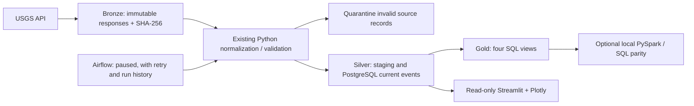

# QuakeTrack: a 4–5 minute college demonstration

Use the Phase 7 interface and the already approved historical dataset. Start the
services using README, open http://localhost:8501 and http://localhost:18080, and
log into Airflow privately with the local admin credentials. Keep the DAG paused.
Reset the dashboard filters. Have the Phase 7 report and saved verification open.
The approved full backfill is already complete; do not download it again on stage.

## 0:00–0:35 · Problem and purpose

“QuakeTrack takes published USGS earthquake observations through an auditable,
repeatable data pipeline and into an interactive dashboard. The engineering
problem includes failed requests, revised observations, duplicates, validation,
provenance and database access control.”

Explain that this is descriptive analytics, not earthquake prediction or an
emergency alert service. The current catalog is a filtered source sample.

## 0:35–1:10 · Architecture and syllabus



Mention PostgreSQL on 55432, dashboard on 8501 and Airflow on 18080. Airflow's
metadata DB is separate. Streamlit uses its own SELECT-only login. Bronze–Silver–Gold
is a logical organization here, not Delta Lake or Iceberg.

## 1:10–1:50 · Historical expansion and repeatability

Show `docs/phase7_preflight.md`: the dynamically calculated 90 complete UTC days
were July 27–October 24, 2026, minimum magnitude 4.0, global earthquake type. The
user approved that exact range before it ran. Show the actual load evidence:

- 90 daily windows, 3,951 fetched, 3,914 inserted, 37 unchanged, zero updated/rejected.
- Current database: **3,954**, including the three original October 25 observations.
- The original 40 complete rows and 48 raw files remained unchanged.
- A separate July 27 repeat fetched 60 and left all 60 unchanged in PostgreSQL.

```powershell
Get-Content data/staging/phase7/repeat.log -Tail 18
.\.venv\Scripts\python -m quaketrack.cli analytics overview --start 2026-07-27 --end 2026-10-26
```

Explain that local staging inserts and PostgreSQL inserts are different counters.
The opt-in preservation flag keeps existing rows unchanged for this historical
expansion. Normal ingestion still accepts a known newer source revision.

## 1:50–3:40 · Dashboard walkthrough

1. **Overview:** show the five cards: 3,954 events, maximum magnitude 7.80, mean
   magnitude 4.57, mean depth 69.81 km and the latest event timestamp. Contrast
   event time with the separately labeled last database-load time. Inspect the
   daily activity and distribution charts. Amber marks partial or unverified
   periods, including the partial October 25 sample. Do not interpret that last
   low bar as a verified global decline. Coordinate cells do not invent countries.
2. **Earthquake Map:** zoom and pan, hover a point, and inspect an event in the
   dropdown. Show magnitude, depth, source place and UTC time. Switch briefly to
   **Offline coordinate view**, which has no external map tiles. Epicenters are
   not damage zones. Return to the basemap if internet is available.
3. **Trends:** choose weekly or monthly frequency; explain partial calendar
   periods. Inspect depth distribution and magnitude versus depth. All summaries
   use SQL-filtered real rows; scatter/map reads are bounded.
4. **Explorer:** enter `Japan` in Location contains. The verified expanded snapshot
   has **274** matching source labels; this is text search, not a country count.
   Show sorting, pagination, optional technical columns and the filtered CSV.
   CSV includes all matching rows, not just the displayed page, and retains full
   timestamp precision. Press **Reset filters** and then **Refresh data**.
5. **Pipeline Monitoring:** show the latest persistence load and separate workflow
   history. Inspect dated archive/contract/Spark evidence and Gold availability.
   This is application history; use the Airflow link for actual scheduler state.

## 3:40–4:25 · Quality, Spark and access control

Show the saved Phase 7 evidence rather than waiting on a full test run:

- Contract compliance: **3,954/3,954**, with no invalid rows or duplicate IDs.
- 115 archived responses verified; 230 current raw files, 48 original files preserved.
- Four Spark aggregates match PostgreSQL over the same 3,954-row snapshot.
- INSERT/UPDATE/DELETE through the dashboard role receive SQLSTATE 42501 even
  when the transaction guard is disabled. ETL write permissions are preserved.
- Existing and new automated tests passed; quote the final report's exact totals.

If asked to demonstrate Spark, run this as an optional additional segment (the
verified job took about 39 seconds, so it is outside the basic four-minute tour):

```powershell
docker compose --profile spark run --rm -v "${PWD}/data/staging/phase7/demo:/inputs:ro" -v "${PWD}/data/staging/phase7/spark:/outputs" spark
```

Explain the explicit DataFrame schema, select/filter/withColumn/groupBy, actions,
Spark SQL and comparison with PostgreSQL. It is local[2], not a distributed cluster.

## 4:25–4:50 · Airflow and conclusion

Open the DAG and show its three tasks and existing successful run history. Keep
its toggle paused; do not create a new historical run or enable recurring ingestion
just to demonstrate the interface. Completed manual backfill work did not advance
its automatic incremental checkpoints.

Conclude: “The project shows how source observations become validated, traceable,
repeatable analytical data, with clear coverage limits and controlled access.”

If a service or internet is unavailable, state the specific limitation. Use saved
verification honestly rather than claiming an unavailable live check succeeded.
The prepared range remains the approved July 27–October 24 scope; do not silently
change it just because the presentation happens on a later date.
