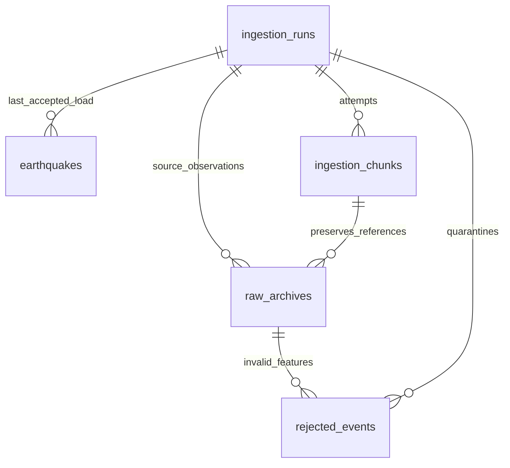

# PostgreSQL schema and operations (Phase 3)

The development connection is localhost:55432, database quaketrack, role
quaketrack_app. PostgreSQL listens on 5432 inside the existing container. Secrets
remain in the existing ignored .env. No additional dependency or service is required.

## Entity relationships



- `schema_migrations`: SQL filename, canonical SHA-256, applied_at. Tracks explicit
  migrations; loading and connecting never create/recreate schema automatically.
- `ingestion_runs`: UUID identity; backfill/replay job type, UTC start/finish,
  requested loaded range, status, staging path, committed processing/action counts,
  successful/skipped chunks, response count and failure detail.
- `earthquakes`: one current row per nonempty USGS event_id. Occurrence and source
  update use TIMESTAMPTZ; magnitude/depth/coordinates use double precision. Nullable
  magnitude/depth preserve unknowns and valid negatives. Magnitude_type, status,
  source, network/code/IDs and both URLs retain the Phase 2 contract. The source
  place remains descriptive text. first_ingested_at is creation time;
  last_ingested_at and last_run_id change only for an accepted newer source revision.
- `ingestion_chunks`: one database loading attempt per extracted window, with
  source run UUID, window key, input fingerprint, status, attempt number, counts,
  representative archive/checksum, completion time and error. A successful row is
  the database persistence checkpoint; failed rows never qualify for resume.
- `raw_archives`: UUID, load run/chunk IDs, source run UUID, raw and metadata paths,
  SHA-256, USGS source, request URL/JSON parameters, original fetch timestamp,
  HTTP status/attempt and response feature count. No full response body is copied
  into PostgreSQL. The same archive can be referenced by different load attempts.
- `rejected_events`: UUID, load run/chunk/archive IDs, source event ID when it was
  valid text, reason code/detail, original invalid feature as JSONB and rejection
  timestamp. JSON null is retained for a completely malformed null feature.

All references are foreign keys. Composite archive/chunk/run keys prevent a rejected
record from linking to another run's archive. Source run UUIDs refer to filesystem
extraction runs and intentionally are not foreign keys to database load runs.

## Constraints and indexes

Primary keys prevent duplicate events and metadata identities. Required fields,
nonempty identifiers/types/sources, finite numeric measurements, bounded coordinates,
finite event timestamps, valid status values, positive attempts, increasing date
ranges and SHA-256 format are checked by PostgreSQL. Run/chunk count equations are
also enforced; a successful chunk must have a completion timestamp.

| Index | Purpose |
|---|---|
| earthquakes primary key | ON CONFLICT identity and single-event lookups |
| occurred_at descending | period filters and recent activity |
| magnitude | strongest-event and magnitude filters |
| event_type + occurred_at | earthquake-only time windows |
| source_updated_at descending | latest source-revision inspection |
| runs started_at descending | ordered run history |
| chunks run_id | run/chunk reporting and foreign-key joins |
| chunks checkpoint_key + input_sha256, success only | DB resume lookup |
| raw_archives run_id | provenance queries |
| rejected_events run_id | quarantine queries |

Unique composite indexes support provenance foreign keys. No coordinate index was
added: there is no demonstrated performance need for the 37-event dataset. The
coordinate-grid/bounding-box query is correct with a scan; profile larger workloads
before adding indexes. No PostGIS or invented country field was introduced.

## Explicit migration workflow

```powershell
.\.venv\Scripts\python -m quaketrack.cli migrate
```

The runner locks migration application, verifies checksums of all previously applied
files and applies pending files plus tracker rows in one transaction. Repeat runs
are no-ops. Changing an applied file, missing a tracked file, inserting an earlier
version or encountering failed SQL raises an error. No destructive migration,
DROP, table recreation or automatic reset is supplied. SQL text uses canonical LF
line endings for checksums so Windows checkout line endings do not cause drift.
Review a new numbered SQL file before explicitly applying it. Existing unrelated
objects are not overwritten; conflicting unmanaged table names cause migration failure.

## Load, replay and checkpoint semantics

```powershell
.\.venv\Scripts\python -m quaketrack.cli load-staging --staging-dir data/staging/phase2-live
.\.venv\Scripts\python -m quaketrack.cli load-staging --staging-dir data/staging/phase2-live --resume
.\.venv\Scripts\python -m quaketrack.cli replay --staging-dir data/staging/phase2-live
```

Both loaders verify source archive checksums. load-staging also verifies and consumes
normalized/quarantine artifacts. replay reconstructs records directly from verified
archived complete responses, skips capped parents/error attempts, reapplies Phase 2
validation/filter/deduplication and checks extraction counters. It requires the Phase 2
state manifest and raw archives, but not normalized/quarantine output files or HTTP.
All current checkpoints in the chosen staging directory are considered. Use a
separate staging directory for a particular selected backfill/filter combination.

Use `backfill ... --load-database` to stage then load the completed windows in its
output directory. Staging commits remain independent: if PostgreSQL fails afterwards,
rerunning the same command with --resume skips verified extraction and retries DB
work. A limited extraction still loads only its completed windows. This command
requires an already migrated DB and never migrates automatically.

Each database window is one transaction, including archives, rejections, event batches,
chunk success and cumulative run counts. An advisory transaction lock serializes
application writers; uniqueness and revision comparison are still enforced in SQL.
INSERT ON CONFLICT DO NOTHING RETURNING identifies inserts; a conditional conflict
update handles remaining rows and RETURNING identifies updates. Others are unchanged.
No internal xmax heuristics or row-by-row select-before-insert checks are used.
Default batch size is 500, configurable from 1 to 1000 for load-staging/replay.

The SQL revision condition requires a non-null incoming source_updated_at that is
newer than stored, or a known timestamp replacing a missing stored timestamp. Equal,
missing or stale incoming timestamps leave the entire existing row untouched.
first_ingested_at is never overwritten. Source occurrence and ingestion time remain
distinct. Batch duplicates are resolved deterministically using Phase 2's policy.

DB resume uses window key plus the fingerprint of normalized records, quarantine
reasons and raw hashes. Only a committed success row can skip work. It does not
trust extraction success as proof of DB persistence. Without --resume, a load is
repeated and reports unchanged records; provenance records each observation.
Skipped chunks contribute zero source/action counts. Counts refer only to committed
windows, and the Phase 2 reconciliation equations remain unchanged.

A failed window rolls back all batches and metadata in that transaction. A separate
transaction records failed chunk/run status and a sanitized primary error, without
SQL/bound values. Earlier committed windows remain available and can be skipped on
retry. If the database is unreachable, recording failure may itself fail; the
original error is preserved. A forcibly killed process may leave a run marked
running, but its uncommitted chunk cannot become a success checkpoint. Auditing
stale running statuses is a Phase 4 operational task.

## Analytical queries

```powershell
.\.venv\Scripts\python -m quaketrack.cli analytics overview --start 2026-10-01 --end 2026-10-02
.\.venv\Scripts\python -m quaketrack.cli analytics strongest_events --start 2026-10-01 --end 2026-10-02 --limit 10
.\.venv\Scripts\python -m quaketrack.cli analytics integrity --start 2026-10-01 --end 2026-10-02
```

SQL files under sql/analytics provide overview (count and depth statistics), UTC
daily/monthly counts, magnitude buckets, strongest events, coordinate-grid distribution,
recent activity, daily magnitude summaries, freshness, run summaries and integrity.
Queries use bound values, an allowlisted query name and read-only transactions.
List outputs accept a 1..1000 limit. Geographic bounds can be provided with
--min-latitude/--max-latitude/--min-longitude/--max-longitude. Aggregates cover the full
selected range. Integrity is deliberately global, not limited to the selected dates.

Geographic distribution uses explicitly labeled 10-degree coordinate cells, not
country classification. Country/administrative totals need a licensed reference
boundary dataset and are not implemented. Recent means recent within the requested
historical period. Freshness separates latest event, source revision, last accepted
row change and latest successful DB load. Resume-only no-op runs do not count as
refreshes. Depth averages exclude nulls and show their denominator; magnitude means
are descriptive reported values across potentially different scales, not energy or
damage estimates. These statistics are not scientific completeness claims.

## Tests and safety

```powershell
.\.venv\Scripts\python -m pytest -q --basetemp=.pytest_tmp/offline
.\.venv\Scripts\python -m pytest --database-tests -q --basetemp=.pytest_tmp/database
```

Default tests run offline and skip DB integration. --database-tests creates a NEW
quaketrack_test_<uuid> database with the local role's CREATEDB privilege. Tests never
reuse or drop an existing DB, never reset development, and only truncate synthetic
data in that session-owned test DB between cases. The database is retained for
inspection; its name is recorded in ignored data/staging/phase3-test-db.json. Previous
test databases are also left intact. A new invocation creates another isolated DB.

The supported setup remains an editable installation from this checkout; SQL files
live alongside the repository. A standalone wheel without these SQL assets is not
claimed. Absolute Phase 2 archive paths remain a portability limitation. Database
roles/production secrets and hosted deployment are not reconfigured in this phase.

## References

- PostgreSQL 17 INSERT / ON CONFLICT: https://www.postgresql.org/docs/17/sql-insert.html
- PostgreSQL 17 explicit/advisory locks: https://www.postgresql.org/docs/17/explicit-locking.html
- Primary project requirements: ../PROJECT.md
