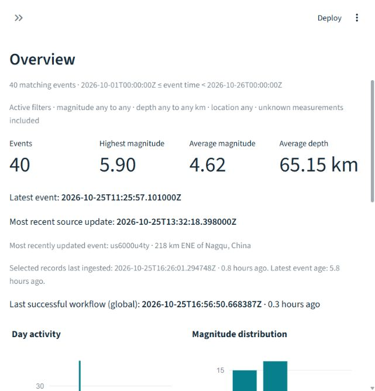
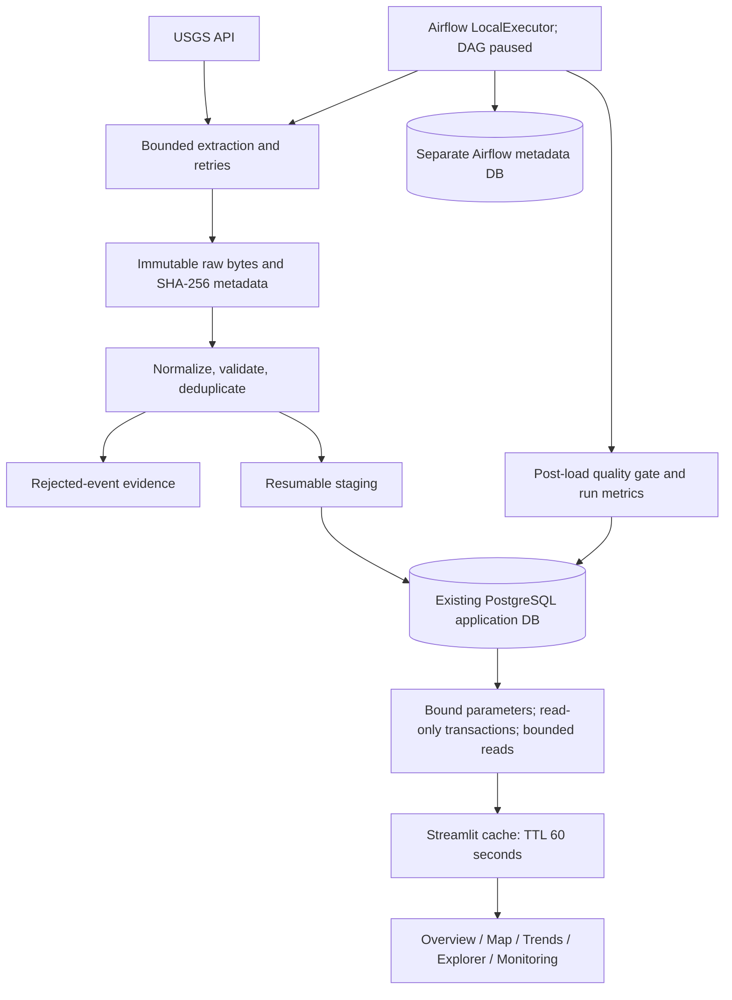

# Phase 5 completion report

Verified locally on October 25, 2026. Phases 1–5 are complete for the bounded
local demonstration. The five-page dashboard, read-only PostgreSQL access,
filters, charts, CSV, application monitoring, Docker deployment, test suite and
presentation documents are implemented and verified. No mandatory implementation
item remains open. This does not claim a complete global catalog, public hosting,
or an enabled unattended schedule.

## Implemented dashboard

| View | Functionality | Live AppTest result |
|---|---|---|
| Overview | Filtered count, maximum/mean magnitude, mean depth, latest event/source revision, updated event ID, freshness, timeline, histogram, recent table | 2 charts, 1 table; passed |
| Earthquake Map | Plotly Scattermap, OpenStreetMap tiles, magnitude color/size, timestamp/depth/place hover, pan/zoom, unknown handling | 1 map; passed; basemap and zoom also checked in browser |
| Trends | Daily/weekly/monthly counts, magnitude/depth histograms, magnitude–depth scatter, strongest list | 4 charts, 1 table; passed |
| Explorer | Bound date/measurement/location filters, deterministic sort, 25/50/100-row pagination, complete filtered CSV up to 10,000 rows | Table and download control passed; 40-row CSV verified |
| Pipeline Monitoring | Latest workflow, status, quality, duration, extracted/inserted/updated/unchanged/quarantined counts, successful-run age, workflow/load histories, coverage checkpoints | 3 tables; passed |

The presentation uses native Streamlit components with a light teal/slate theme,
consistent spacing, loading indicators, friendly connection failures, and explicit
empty states. Responsive narrow-width layout was inspected in the running browser.
A screenshot of the actual overview is included below:



Navigation and filters share one application entry point; each page has its own
rendering branch. No fabricated dataset, ML, prediction, country inference or
hazard scoring is included. Epicenters are explicitly not damage zones.

## Architecture and database access



Configuration reuses `load_settings` and `create_database_engine`. Windows connects
to `localhost:55432`; Docker connects to the existing `postgres:5432` service over
its private network. No second earthquake database, new schema, migration change,
or automatic startup DDL was introduced. SQLAlchemy pools connections and context
managers return them after each transaction. Default session transactions and each
query are read-only; a real PostgreSQL integration test confirms DELETE is rejected.
This is connection-level protection; the existing local ETL role still has write
permissions for ingestion. A public deployment would need a dedicated SELECT-only
role, access control, TLS and hosting work beyond this local delivery.

The access layer restricts analytics to `event_type=earthquake`, and implements coverage/threshold metadata, filtered overview,
UTC day/week/month aggregates, adaptive magnitude/depth histograms, ordered event
pages, complete bounded CSV snapshots, and workflow/load/checkpoint history.
It follows Phase 3 analytics semantics and reuses the existing health view and
integrity/overview queries for verification. Existing SQL files remain unchanged.
The [ER diagram and schema](database.md) remain available from Phase 3; Phase 4 added operational checkpoint fields. New queries share a single filter predicate because the older analytics interface
does not support all magnitude/depth/location filters.

All user values are bound. Sort, interval and measurement choices use allowlists.
Location search treats `%`, `_` and the escape character literally. Both UI date
inputs are inclusive UTC dates, translated to `[start midnight, next midnight)`.
Magnitude/depth bounds are inclusive. Unknown measurements are included by default
even when bounds are active; disabling that option requires both measurements.
Negative values remain unchanged. Averages ignore nulls; distributions label them.
Weekly buckets start Monday. Only periods containing stored events are plotted;
gaps do not establish zero real-world activity.

The map and scatter read at most 5,000 newest matches with visible limit notices.
Frequency, statistics and histograms aggregate all matches in SQL. Adaptive
histogram widths keep approximately 42 output bins without silently dropping
measurements. Explorer has bounded page reads and a navigation cap; complete
CSV export requires no more than 10,000 matches and checks for concurrent growth.
Results are cached for 60 seconds, up to 256 entries; Refresh data clears them.
The engine is a process-lifetime cached resource. Individual result sets can reflect
different commits if an ingestion runs concurrently; they are not one global
transactional dashboard snapshot.

Operational history deliberately remains global. Workflow parents in
`pipeline_health` and child/standalone persistence loads are separate, preventing
double-counted ingestion totals. Sensitive error messages are omitted from UI
tables. All operational timestamps are rendered explicitly in UTC. Application
history does not prove live Airflow state: the page says so and links to Airflow,
without receiving Airflow credentials or asserting the paused DAG is active.

## Real data and preservation

| Measurement | Verified value |
|---|---|
| Real stored events | **40**, unchanged from baseline |
| Actual occurrence span | 2026-10-01T00:28:22.215Z to 2026-10-25T11:25:57.101Z |
| Dates containing events | **2**: October 1 and October 25 |
| Source request filters | `eventtype=earthquake`; minimum magnitudes **4** and **5** |
| Magnitude range / mean | 4.1–5.9 / 4.6175 |
| Depth range / mean | 7–637.906 km / 65.146925 km |
| Latest source revision | 2026-10-25T13:32:18.398Z |
| Unknown magnitude/depth in current sample | 0 / 0; fixture cases exercise unknowns |
| Existing event rows preserved byte-for-byte after JSON serialization | 40 / 40, including ingestion timestamps |
| Existing raw files with unchanged SHA-256 | 46 / 46 |
| Raw file count after bounded verification | 48: one new response plus its metadata |
| Duplicate IDs / invalid required fields / orphan events | 0 / 0 / 0 |
| Inconsistent run counters / incomplete successful chunks | 0 / 0 |

The original 37 events cover October 1 at minimum magnitude 4; three October 25
events came from the Phase 4 incremental minimum-magnitude-5 window. This is not
continuous coverage across the displayed span. Thresholds differ, completeness
is limited, and mixed magnitude scales complicate comparisons. The coverage notice
appears on every dashboard page. No additional broad backfill was launched.

Before verification, `scripts/verify_dashboard.py --snapshot` saved all existing
event rows and SHA-256 values for every raw file to ignored
`data/staging/phase5/before.json`. The final read-only verifier compared all rows
and files, verified migrations, compared the overview to Phase 3 SQL, checked
all pages, verified a 40-row CSV, tested the `Japan` filter (**3** matches), and
checked a deliberately empty location search. Evidence is in ignored
`data/staging/phase5/verification.json`. These ignored artifacts are local evidence,
not files included in a fresh clone.

## Airflow end-to-end verification

All three real DAG import/dependency/configuration checks passed in Airflow's
Python runtime. The services and API health endpoint reported healthy metadata
database, scheduler and DAG processor. The DAG was checked through the authenticated
API before and after execution and remained **paused**. Failure simulation stayed
disabled.

One real bounded `airflow dags test --use-executor` execution used LocalExecutor
and all three actual tasks. It requested only
`[2026-10-01T00:00:00Z, 2026-10-01T06:00:00Z)` with minimum magnitude 4:

- Airflow run: `manual__2026-10-25T16:56:37.705949+00:00`.
- Application workflow: `d4b8eed9-765f-5940-9db3-c29d8b9b9fda`.
- Final Airflow state: success; DAG duration approximately **19.53 seconds**.
- One extraction HTTP attempt; **12 fetched**, **0 inserted**, **0 updated**,
  **12 unchanged**, **0 quarantined** in PostgreSQL.
- Quality checks passed; no duplicates or count inconsistencies.
- Manual historical verification did not advance automatic coverage checkpoints.
- Seven successful live workflow runs now exist: six Phase 4 runs plus this test.

The extraction log also records 12 inserts into its new **local staging catalog**;
the PostgreSQL workflow counters correctly report zero inserts and 12 unchanged.
These are distinct layers. The saved redacted task log and authenticated API result
are in `data/staging/phase5/airflow-test.log` and `airflow-verification.json`.
The bounded run succeeded on its first task attempts; the verification harness
was corrected to handle older API runs with null logical dates and then checked
the existing successful run without launching another ingestion.

This verifies actual LocalExecutor tasks and ETL, not a new unattended hourly
scheduler tick. No unpause command was executed. Credentials were checked against
the captured run log without printing their values; none appeared. A separate scan of recent Airflow service logs (151,414 bytes) and dashboard logs (503 bytes) also found no configured credentials; only pass/fail summaries were printed.

## Automated tests and deployment checks

Baseline: **125 passed** in 37.90 seconds. Final suite: **151 passed** in
48.48 seconds: 120 offline cases and 31 PostgreSQL integration cases, including
all original tests. Separately, **3 actual Airflow DAG checks passed**.
This is 154 automated test/check cases across the two runtimes, plus live page
and bounded DAG verification; those live checks are not added to the pytest count.

The 26 new pytest cases cover UTC inclusive-date translation and offset conversion,
invalid date/numeric/search bounds, bound literal searches, negative magnitude/depth,
unknown values, empty datasets, coordinate safety, chart construction, CSV quoting
and UTC/null preservation, freshness/future clocks, application startup, all five
pages with populated and empty fixtures, safe database errors, filter reruns,
monitoring metrics/error redaction, real SQL filtering and aggregation, pagination,
read-only rejection and invalid dynamic query controls. Synthetic records live
only in mocks or a new `quaketrack_test_<uuid>` database, never development.
The isolated database is retained for inspection rather than dropped.

A subsequent precision-focused rerun passed all 24 dashboard tests in 4.63 seconds after ensuring CSV timestamps retain fractional seconds.

`pip check` passed. `compileall` passed for src/dashboard/scripts/tests. The pinned
Streamlit 1.66.1 / Plotly 7.1.0 host environment installed successfully on Windows
Python 3.14.6. The optional dashboard image built successfully with Python 3.12;
its health endpoint returned HTTP 200. The real browser rendered database-backed
overview KPIs, map tiles and controls; zoom interaction worked. All five views were
also run against the real DB through AppTest. Automated page checks do not replace
every possible browser interaction or large-dataset load testing.

The final services are running and healthy:

| Service | Local endpoint | State |
|---|---|---|
| PostgreSQL 17 | localhost:55432 | Healthy; existing data volume preserved |
| Airflow 3.3.2 | http://localhost:18080 | Healthy; earthquake DAG paused |
| Airflow metadata PostgreSQL 16 | Internal Docker network only | Healthy |
| Streamlit dashboard | http://localhost:8501 | Healthy; Docker profile `dashboard` |

Docker starts only the requested profiles; dashboard does not require Airflow to
run. The Docker dashboard has no raw archive mount and no Airflow credentials.
It connects only to the existing application database for displayed data. Host
Python remains an alternative; do not start it on 8501 while Docker uses that port.

## Measurements and proposed historical extension

Measured uncached query wall times against this local 40-event database:

| Query | Milliseconds |
|---|---:|
| Coverage | 9.70 |
| Overview | 6.38 |
| Timeline | 7.24 |
| Distribution | 13.00 |
| Event page | 7.39 |
| Complete CSV query/count/serialization | 13.46 |
| Monitoring (four bounded queries) | 30.82 |

These are single local observations, not performance guarantees or large-catalog
benchmarks. The earthquake relation including its indexes occupied 131,072 bytes
at measurement time. Caching avoids redundant rerun work but expiry can briefly
leave displayed values stale.

Proposed demonstration extension, **not executed**: September 25 through October
24, 2026 (exclusive end October 25), minimum magnitude **4.5**, earthquake type,
daily windows. One read-only USGS `/count` request returned **753 candidate events**
in **0.77 seconds**. This downloaded only a count, not the event dataset. Source
catalog revisions can change that estimate. Expect approximately **30 extraction
requests** before retries, plus the one count request already made. Current source
volume is below the per-request 1,000-event cap even for the whole proposed range;
window splitting remains available if the source changes.

Estimated growth is up to 753 candidate rows before overlap with existing IDs,
roughly a few MiB for raw GeoJSON, curated rows/indexes and provenance. This is a
planning estimate, not a measured import size; retained source revisions and retries
add storage. Allow roughly **1–5 minutes** for a small laptop/network demonstration,
with no guaranteed runtime. Use a fresh staging directory and inspect counts after
loading. This gives more useful charts but remains a magnitude-filtered catalog.

Only after approval, the proposed bounded command would be:

```powershell
.\.venv\Scripts\python -m quaketrack.cli backfill --start 2026-09-25 --end 2026-10-25 --min-magnitude 4.5 --window-days 1 --max-windows 30 --output-dir data/staging/demo-30d-mag45 --load-database
```

No larger ingestion is necessary to verify the implemented dashboard.

## Files delivered

New files:

- `dashboard/app.py`: public Streamlit entry point.
- `src/quaketrack/dashboard/{__init__,app,data,charts}.py`: presentation, shared
  filters/read-only queries, serialization/freshness and Plotly figures.
- `.streamlit/config.toml`: local bind, theme, standard port and telemetry preference.
- `docker/dashboard/Dockerfile`: optional Linux dashboard runtime.
- `requirements-dashboard-lock.txt`: resolved Windows Python 3.14 dependency snapshot.
- `tests/test_dashboard.py`: offline semantic and AppTest cases.
- `scripts/verify_dashboard.py`: read-only live checks and preservation manifest.
- `scripts/verify_phase5_airflow.py`: guarded bounded execution/API verification.
- `docs/phase5_report.md`, `docs/DEMO_GUIDE.md`, `docs/VIVA_QA.md` (40 questions),
  `docs/images/phase5-overview.png`.

Modified files: `pyproject.toml` (optional pinned dashboard dependencies),
`docker-compose.yml` (dashboard profile), `.env.example` (optional Streamlit port),
`tests/integration/test_postgres.py` (two isolated DB cases), `README.md` and
`docs/implementation_plan.md` (current status/setup). Existing migrations, ETL,
DAG, core dependency lock and all Phase 1–4 data remain intact.

## Executed and repeatable commands

Executed: baseline/full pytest, dashboard dependency installation, Docker dashboard
build/start, `verify_dashboard.py --snapshot` and verification, real DAG import
checks, the bounded DAG verification, inspection of API health/paused state,
`pip check`, `compileall`, read-only query timings, one USGS count request, and
Git status/diff inspection. No files were staged, committed or pushed; no branch
or merge was created, no database/volume was reset, and no archives were overwritten.

For the existing configured checkout:

```powershell
.\.venv\Scripts\python -m pip install -e ".[dev,dashboard]"
docker compose up -d --wait postgres
.\.venv\Scripts\python -m quaketrack.cli migrate
.\.venv\Scripts\python scripts/setup_airflow.py
docker compose --profile airflow build airflow
docker compose --profile airflow up -d --wait airflow
docker compose --profile dashboard build dashboard
docker compose --profile dashboard up -d --wait dashboard
.\.venv\Scripts\python -m pytest --database-tests -q --basetemp=.pytest_tmp/final-check
docker compose exec -T airflow python /workspace/scripts/verify_airflow_dag.py
.\.venv\Scripts\python scripts/verify_dashboard.py
```

Fresh clone setup, explicit migrations, one-day historical ingestion, optional
Windows Streamlit, safe shutdown and troubleshooting are in README. The existing
`.env` must be preserved; fresh installations need locally generated passwords.
The demo guide includes a timed 4–5 minute walkthrough and architecture explanation.

## Limitations and remaining manual actions

The incomplete 40-event catalog limits interpretation. Map tiles require internet;
raw replay and existing data analytics do not require the USGS API. Chart/event/export
limits are deliberate and visible. The overview shows the last successful workflow separately from event ingestion age, and each view shows active filters and the coverage-query timestamp. Global operation tables are not earthquake-filtered.
Live Airflow status must be checked in Airflow; application history alone cannot
establish scheduling state. Query benchmarks cover only this small local dataset.
No public deployment, load test, forecast or comprehensive historical import is claimed.

No mandatory manual implementation step remains. Open the running dashboard for
the demonstration, log into Airflow with local credentials if needed, and review
the unstaged changes. A larger dataset, an enabled schedule, or Git publication
requires a subsequent explicit instruction. Phase 5 ends here with the DAG paused.

References used for implementation: [Streamlit AppTest](https://docs.streamlit.io/develop/api-reference/app-testing/st.testing.v1.apptest),
[Plotly documentation](https://plotly.com/python/), and the existing project
[USGS source contract](source_contract.md).
