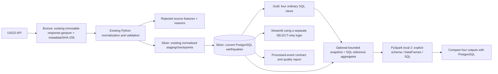

# Phase 6: syllabus alignment completion report

Verified locally on October 25, 2026. All four Phase 6 enhancements are complete:
logical Bronze–Silver–Gold organization, an optional executable local PySpark
demonstration, a versioned processed-event contract and quality report, and a
separate PostgreSQL dashboard reader with enforced SELECT permissions.

No original ETL was replaced. The existing ingestion implementation uses Python
normalization/validation functions; Pandas is part of the dashboard dependency
stack rather than the core ETL algorithm. Spark was added solely as an isolated
batch-processing demonstration. No machine learning, cloud infrastructure, Kafka,
Flink, Debezium or distributed cluster was introduced.

## Verified baseline

- Clean `main` checkout at `57f074e` before implementation.
- Existing suite: **151 passed in 48.83 seconds**.
- PostgreSQL, Airflow metadata DB, Airflow and Streamlit were healthy on their
  existing ports: 55432, internal-only metadata DB, 18080 and 8501 respectively.
- Three real Airflow DAG import/dependency/configuration checks passed.
- Development contained 40 real events and 48 raw files (24 response/metadata pairs).
- A new ignored `data/staging/phase6/before.json` captured every event field and
  SHA-256 of every raw file before changes. It was not overwritten.
- Role inspection found `quaketrack_app` was the Docker bootstrap superuser,
  with CREATEDB/CREATEROLE/BYPASSRLS and write privileges. No reader already existed.
  Its existing privileges and password were preserved after assessing that Airflow,
  ingestion, migrations and isolated DB tests depend on this identity.

PROJECT.md, README, the five completion reports, database and Airflow documentation,
existing schema/migrations, ETL validators, dashboard queries and Compose settings
were reviewed before implementation. The Phase 6 request authorizes this small
optional Spark extension beyond the original five-phase blueprint.

## A. Logical Bronze–Silver–Gold



**Bronze** remains `data/raw`. No archive was moved, rewritten or relabeled as a
different physical format. Original payload bytes, source request metadata, UTC
fetch times, run IDs and hashes are retained. HTTP errors, retries and small
connectivity samples can coexist here; their feature counts are not a unique-event
denominator.

**Silver** is the existing validated normalized staging plus current PostgreSQL
`earthquakes` table. PostgreSQL has one current representation per USGS ID.
Quarantine remains separate. Source occurrence/update times are preserved; run,
chunk and raw-archive audit relationships retain lineage. The verifier reuses
`normalize_feature` and `validated_record` to compare stored observations against
valid archived representations. All **40/40** current rows matched; all **24/24**
response payload hashes matched metadata. The comparison excludes invalid source
features rather than accepting them as Silver evidence. It is a provenance check,
not a new source revision-selection algorithm or ingestion job.

**Gold** consists of four ordinary views added by the additive, checksum-tracked
migration `005_add_gold_views.sql`:

| View | Grouping and measures |
|---|---|
| `gold_daily_earthquakes` | UTC date; event count; known magnitude/depth counts; mean/max magnitude; mean depth |
| `gold_magnitude_distribution` | Magnitude category; event count |
| `gold_monthly_earthquakes` | UTC month; event count; mean/max magnitude; mean depth |
| `gold_depth_by_magnitude` | Magnitude category; event count; known depth count; mean depth |

All views filter `event_type='earthquake'`. Categories use the existing analytical
thresholds: `<0`, `0-<2`, `2-<4`, `4-<6`, `6+`, and `unknown`. Labels are explicit;
nulls are not zero, and negative values are not clipped. Averages exclude nulls.
Dates are UTC and absent dates are not manufactured as zero-count observations.
Ordinary views avoid duplicate production storage and refresh scheduling for this
small dataset. Existing migrations 001–004 and existing analytical SQL remain intact.

This is logical medallion organization over files and PostgreSQL. It is not Delta
Lake, Iceberg, Hudi, cloud object storage or a transactional lakehouse. The optional
small snapshot is a reproducibility artifact, not a second production Silver store.

## B. Real local PySpark demonstration

Java was not present on the inspected Windows PATH. The safe setup used a separate
Docker image based on `python:3.12-slim-bookworm`, OpenJDK **17.0.21**, pinned
**PySpark 4.1.3**, and the existing pinned core dependencies. No host Java or Spark
installation was needed. Apache's documentation specifies Python 3.10+ and Java
17+ for this PySpark release. The tested runtime uses Python 3.12.

The optional `spark` Compose profile runs `local[2]`, a UTC SQL session, two shuffle
partitions, a 512 MiB driver configuration and no exposed Spark UI. It receives no
database or Airflow credentials. Source/tests/contracts and its input are mounted
read-only; only its report directory is writable. It starts no Spark/Hadoop cluster
services. The job is never imported or started by normal ingestion or Streamlit.

The read-only export creates Silver records and all four PostgreSQL reference
datasets inside the **same REPEATABLE READ transaction**. Export is capped at
10,000 current rows and refuses existing output files. Snapshot input SHA-256:

`87a265ac2cef01e927fc579e9b685e5405f4ec9a0295da69d2f2508970ac03f2`

The job validates processed input before creating a DataFrame with explicit
event ID, occurrence/update timestamps, magnitude, depth, latitude/longitude and
event-type fields. Required fields are non-nullable; missing optional measurements
and source update timestamps retain their nullable types. It demonstrates:

- `select` to choose analytical fields.
- `filter` to exclude non-earthquake classifications.
- `withColumn` to derive UTC dates and magnitude categories.
- `groupBy` with count/mean/max aggregations.
- `createOrReplaceTempView` and Spark SQL for monthly results.
- `collect` and `count` as actions on lazy transformation plans.

The actual Spark SQL is:

```sql
SELECT CAST(date_trunc('month',occurred_at) AS DATE) AS event_month,
       COUNT(*) AS event_count, AVG(magnitude) AS average_magnitude,
       MAX(magnitude) AS maximum_magnitude, AVG(depth_km) AS average_depth_km
FROM silver_earthquakes
GROUP BY 1;
```

Execution succeeded on **40 real rows**. All four outputs matched PostgreSQL:

| Dataset | Actual result |
|---|---|
| Daily | October 1: 37 events; October 25: 3 |
| Magnitude categories | `4-<6`: 40 events |
| Monthly | October: 40; average magnitude 4.6175; maximum 5.9 |
| Average depth by category | `4-<6`: 40 known depths; mean 65.146925 km |

The result comparator matches group keys independently of database collation.
Numerical results allow relative/absolute tolerance `1e-10`; the observed depth
mean difference was ordinary floating-point rounding
(`65.14692499999998` versus `65.146925`). Integer count changes fail comparison.
The verification also links the Spark input hash to the exported snapshot and
quality report. A new UUID-named report directory is created each run.

The measured job wall time was **18.096 seconds**, including JVM startup and
actions. Five real Spark tests passed in **17.47 seconds**. These test explicit
schema/nullability, local mode/UTC, all category boundaries, negative and unknown
measurements, classification filtering, daily/monthly SQL results, empty input,
invalid/duplicate input rejection and result comparison. No Pandas parity claim
is made: the equivalent reference is PostgreSQL.

This tiny dataset does not need Spark for performance. Warm local Gold view reads
measured 5.728 ms (daily), 4.090 ms (distribution), 2.864 ms (monthly), and 3.926 ms
(depth/category). These are single observations on 40 rows, not throughput
benchmarks. Spark demonstrates APIs and execution concepts on one machine; it
does not prove multi-machine speedup. Initial image downloads take several minutes.
The native-Hadoop-library warning occurred and the local job used built-in Java
classes successfully; no Hadoop service was deployed.

## C. Contract and governance

`contracts/earthquake.v1.json` formally describes all 18 normalized fields and
their required/optional status. It records finite numeric types, coordinate ranges,
UTC/millisecond timestamp policy, negative and null policies, ID uniqueness,
source-update precedence and required provenance. Existing validators supply the
domain checks. The normalized-record boundary is intentionally stricter about
already-processed types and explicit UTC than raw-source parsing, which may convert
numeric strings. It does not rewrite input records or alter the ETL's rules.

Required normalized fields are event ID, occurrence time, latitude, longitude,
event type and source. Optional measurements/timestamps may be absent or null.
Persisted-scope validation additionally requires a valid `last_run_id` UUID; actual
FK integrity and source reproducibility are checked separately. A missing source
update must not replace a known existing revision. No data is modified to make the
report pass.

Generated quality report:

| Measure | Result |
|---|---:|
| Processed rows checked | 40 |
| Valid rows | 40 |
| Invalid rows | 0 |
| Repeated distinct event IDs / excess duplicate rows | 0 / 0 |
| Missing required field values | 0 |
| Rows with provided invalid coordinates | 0 |
| Contract compliance | 100.0% |

The denominator is every supplied **processed Silver row**, before any deduplication,
including repeated IDs. All rows belonging to a duplicate-ID group fail dataset
uniqueness. Missing-required count measures field occurrences; coordinate-failure
count measures rows with supplied invalid coordinate values. Empty input has null
compliance percentage. This is not a raw API acceptance rate and does not imply
complete earthquake coverage or that source errors never occurred.

Evidence is in ignored `data/staging/phase6/demo/quality-report.json` alongside the
bounded Silver snapshot. Raw records are distinguished from processed records in
the report and contract. Existing quarantine is neither merged into Silver nor
counted as valid analytical input.

## D. Dedicated PostgreSQL dashboard reader

`scripts/setup_dashboard.py` created `quaketrack_dashboard` with a generated local
password in ignored `.env`, then successfully ran again without rotating it.
The repeatable setup grants CONNECT, public schema USAGE and specific SELECT rights:

- Event rows, migration checksums, pipeline checkpoints and the four Gold views.
- Only `request_parameters` from `raw_archives`.
- Only dashboard-used columns from `ingestion_runs` and `pipeline_health`;
  sensitive error text and archive paths are not granted.

The role has no SUPERUSER, CREATEDB, CREATEROLE, REPLICATION or BYPASSRLS attributes,
no memberships and no ownership/create authority over permanent project objects.
Existing powerful roles are refused rather than having permissions revoked.
New objects are not automatically readable: reviewed grants must be added and
setup rerun. Existing PostgreSQL PUBLIC temporary-table permissions were not
revoked because that would affect unrelated users; the security boundary here is
permanent project data and required read access.

Streamlit uses `DASHBOARD_DB_USER` / `DASHBOARD_DB_PASSWORD` and does not fall back
to ETL credentials. Its actual container contains **no POSTGRES_PASSWORD**. ETL
and Airflow retain the original `POSTGRES_USER` / `POSTGRES_PASSWORD`. Client
read-only transactions remain an additional guard.

Both isolated tests and live verification explicitly turned off transaction
read-only mode and still received **SQLSTATE 42501 (insufficient_privilege)** for
INSERT, UPDATE and DELETE. The live probes all use `WHERE false`, so even a
misconfigured role could not change development records. Isolated tests also
confirmed denial of rejected-event reads, ingestion error text and raw archive paths.
The original ETL identity retained all three DML permissions; actual upserts with
that identity still pass in isolated databases. It remains a privileged local
bootstrap role; demoting it is outside this non-destructive change.

## Regression and final verification

- Host full suite: **170 passed, 1 skipped in 57.45 seconds**. This includes all
  original 151 cases plus 17 governance/layer/configuration cases and 2 new DB
  cases. The skipped item is the optional Spark test module on the host, where
  PySpark is intentionally not installed.
- Separate real Spark suite: **5 passed**. Combined pytest cases: **175 passed**
  across the two runtimes. Separately, **3 real Airflow DAG checks passed**.
- Failed-migration rollback coverage is preserved; its temporary migration number
  now derives from the latest migration instead of hardcoding 005.
- All five pages passed live AppTest regression with real DB data and the reader
  role, both on Windows and inside the deployed Python 3.12 dashboard container.
  Overview: 2 charts/1 table; map: 1 chart; trends: 4 charts/1 table; Explorer: 1
  table/export; monitoring: 3 tables. The 40-row CSV and Japan filter (3 matches)
  still passed; deliberately empty filters produced the expected state.
- All **40 complete event rows** and **48 raw files** exactly match the new Phase
  6 preservation manifest. No API refresh or backfill was run; no raw files added.
- Migration checksums are valid, all four Gold views are readable, and live results
  still match the actual Spark output.
- PostgreSQL and dashboard health checks passed. Airflow API reported healthy
  metadata DB, scheduler and DAG processor; authenticated DAG state is **paused**.
  No Phase 6 ingestion execution or unpause occurred.
- `pip check`, syntax compilation and Git whitespace checks passed.
- Configured secrets were scanned without printing them: no matches in changed
  source files or recent dashboard (503 bytes), Airflow (213,751 bytes) and
  PostgreSQL (44,459 bytes) service logs at verification time.

Local evidence files are `data/staging/phase6/before.json`,
`demo/{silver-snapshot,quality-report}.json`,
`spark/run-e68900de740b4d069428e8b34aa145e0/spark-report.json`,
`verification.json` and `final-checks.json`. These are intentionally ignored local
data/evidence, not promised artifacts in a fresh Git clone. Source reports and
repeatable commands are delivered in the repository.

## Files added and modified

Added: `contracts/earthquake.v1.json`, migration 005, `docker/spark/Dockerfile`,
`src/quaketrack/{governance,medallion,phase6,spark_demo}.py`,
`src/quaketrack/dashboard/security.py`, `scripts/setup_dashboard.py`,
`scripts/verify_phase6.py`, `tests/test_phase6.py`, `tests/spark/test_local_spark.py`,
this report and `docs/SYLLABUS_MAPPING.md`.

Modified: `pyproject.toml` (optional pinned Spark extra), `docker-compose.yml`
(Spark profile and separate dashboard credentials), `.env.example`, dashboard
connection/query modules (explicit safe health columns), PostgreSQL integration
tests, README and viva documentation (20 additional questions, 60 total).
The ignored `.env` gained only dashboard credential configuration; existing ETL
and Airflow secret values were not rotated. Existing source archives, ETL, DAG,
ports, tables and dependency lockfiles remain intact.

## Demonstration commands

For a configured checkout, enable the additive schema and reader setup:

```powershell
docker compose up -d --wait postgres
.\.venv\Scripts\python -m quaketrack.cli migrate
.\.venv\Scripts\python scripts/setup_dashboard.py
docker compose --profile dashboard build dashboard
docker compose --profile dashboard up -d --wait dashboard
```

Prepare once, then run Spark as often as needed:

```powershell
.\.venv\Scripts\python -m quaketrack.phase6 --verify-archives
docker compose --profile spark build spark
docker compose --profile spark run --rm spark
docker compose --profile spark run --rm spark python -m pytest tests/spark -q -p no:cacheprovider
.\.venv\Scripts\python scripts/verify_phase6.py
```

The default preparation files already exist in this verified checkout, so skip
the preparation command when showing the saved snapshot. To create a separate
snapshot, use a fresh `--output-dir` and the matching bind-mount command in README.
Files are never silently overwritten. `verify_phase6.py` uses the default snapshot
and the pre-change preservation manifest for this checkout.

Full tests and DAG checks:

```powershell
.\.venv\Scripts\python -m pytest --database-tests -q --basetemp=.pytest_tmp/phase6-check
.\.venv\Scripts\python scripts/verify_dashboard.py
docker compose exec -T airflow python /workspace/scripts/verify_airflow_dag.py
```

The host role needs CREATEDB for isolated DB tests. A fresh test database and reader
role are retained for inspection; no development rows or existing roles are reset.
Spark's `run --rm` removes only its temporary container and keeps report bind mounts.
No database volumes are removed. The dashboard stays at http://localhost:8501 and
Airflow at http://localhost:18080.

## Syllabus coverage and limitations

See [SYLLABUS_MAPPING.md](SYLLABUS_MAPPING.md) for accurate topic groups: storage
organization, relational analytics, DataFrames/lazy execution, Spark SQL,
contracts/governance, provenance and database least privilege. No official numbered
syllabus was provided, so module numbers were not invented.

The 40 observations still cover only October 1 and October 25, with differing
ingestion thresholds. Neither Spark parity nor 100% processed compliance implies
complete scientific coverage. Spark is optional and slower than SQL at this size.
It demonstrates one-machine execution only. Gold is not automatically wired into
the filter-rich dashboard because those existing parameterized queries preserve
all seven filter semantics; the reusable views are used for syllabus analytics and
Spark comparisons. The dashboard still distinguishes application history from live
scheduler status. Basemap tiles still need internet. Public hosting, ETL-role
hardening, large-scale performance and table-format lakehouses remain outside scope.

No mandatory Phase 6 requirement remains incomplete. No files were staged,
committed or pushed, no branches were created or merged, and no destructive
operations were performed. The project remains running with the DAG paused.

References: [Apache PySpark 4.1.3 installation](https://spark.apache.org/docs/4.1.3/api/python/getting_started/install.html),
[PostgreSQL 17 GRANT](https://www.postgresql.org/docs/17/sql-grant.html).
